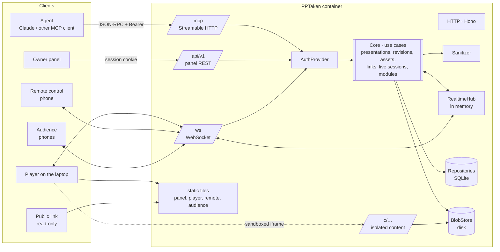
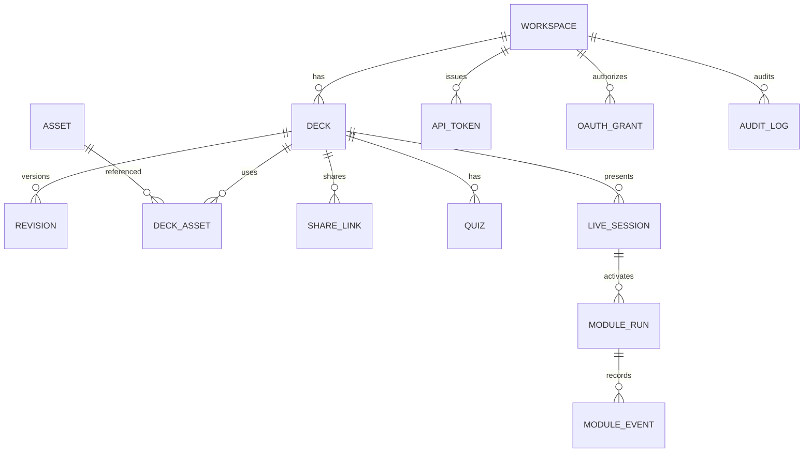
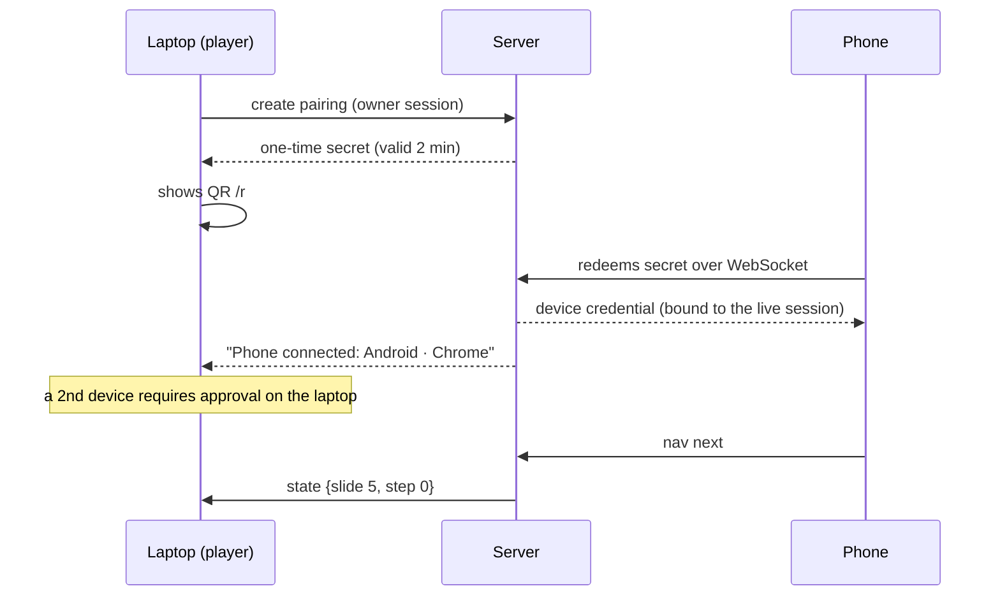

# 02 · Architecture

> The decisions and their reasons are in `03-stack-and-adrs.md`. Here we describe **how the pieces fit**.

## 1. Overview

One Node.js process, one port, one data volume.



Central idea (*hexagonal* architecture, or ports and adapters): the **core** holds the product rules and knows nothing about HTTP, SQLite or WebSocket. It talks to the outside through **interfaces** (ports). The **inputs** (MCP, REST, WebSocket) and the **outputs** (SQLite, disk, memory) are interchangeable adapters. That is what lets the cloud use the same core with Postgres, S3 and OIDC.

## 2. Route map

| Route | For whom | Authentication | Notes |
|---|---|---|---|
| `/` , `/welcome` | Owner | Install code → session | Initial wizard and "Connect your agent" |
| `/panel/*` | Owner | Session | Presentations, revisions, tokens, links, quizzes |
| `/p/:deckId` | Presenter | Session | Player with notes, remote and audience |
| `/v/:shareToken` | Anyone with the link | Token in the path | Read-only player, no notes |
| `/r` (secret in `#fragment`) | Presenter's phone | Pairing | Remote control |
| `/a/:code` | Audience | Anonymous | Quiz and questions |
| `/c/:deckId/:rev/…` | Player iframes | Short-lived content token | Deck document and assets; `sandbox` CSP headers |
| `/mcp` | Agent | Bearer (API token or OAuth) | Streamable HTTP, stateless |
| `/api/v1/*` | Panel, player | Session (or Bearer) | REST |
| `/ws` | Player, remote, audience | Per role | One WebSocket per client |
| `/oauth/*`, `/.well-known/oauth-*` | MCP clients | — | Built-in authorization server |
| `/healthz`, `/readyz`, `/metrics` | Operations | `/metrics` with token | |

The remote's secret goes in the **fragment** (`#…`) because the browser does not send it to the server and it does not appear in logs.

## 3. Monorepo structure

```
pptaken/
├─ apps/
│  ├─ server/              # Composition: wires Hono + adapters + core. CLI (backup, reset-password). Dockerfile
│  ├─ web/                 # Multi-page Vite (Svelte 5): welcome, panel, player, remote, audience
│  └─ docs/                # Documentation site (created in beta)
├─ packages/
│  ├─ schema/              # [Apache-2.0] pptaken.deck format, quiz, real-time messages (Zod → types + JSON Schema)
│  ├─ player/              # [Apache-2.0] Player engine and iframe runtime. No framework
│  ├─ core/                # Domain and use cases. Defines the PORTS. Zero I/O
│  ├─ sanitizer/           # HTML/CSS/SVG allowlist + XSS test corpus
│  ├─ mcp/                 # MCP tool definitions on top of core
│  ├─ realtime/            # Message protocol + in-memory RealtimeHub
│  ├─ storage-sqlite/      # Adapter: repositories + migrations
│  ├─ blob-fs/             # Adapter: on-disk BlobStore
│  ├─ auth-local/          # Adapter: single owner, sessions, API tokens, minimal OAuth server
│  ├─ audience-kit/        # Audience module contract + shared utilities (ephemeral identity, limits)
│  ├─ module-qa/           # Anonymous questions with votes
│  ├─ module-quiz/         # Quiz
│  ├─ ui/                  # Design tokens and shared Svelte components
│  └─ testing/             # Contract test suites for adapters, data factories
├─ docker/                 # Dockerfile, compose.yaml, Caddyfile
├─ docs/                   # foundation/, adr/, guides
├─ .github/                # workflows, templates, CODEOWNERS, dependabot/renovate
└─ (README, LICENSE, CONTRIBUTING, SECURITY, CODE_OF_CONDUCT, GOVERNANCE, CHANGELOG)
```

**Dependency rules** (enforced with a lint rule in CI):

```
schema  ←  player
schema  ←  core  ←  mcp, realtime, audience-kit ← module-*
core (ports)  ←  storage-sqlite, blob-fs, auth-local      (adapters implement ports)
apps/server  →  everything above        (the only place where things are "wired")
apps/web     →  schema, player, ui      (never imports core or adapters)
```

`core` cannot import any adapter or `hono`, `ws`, `better-sqlite3`. If a `core` test needs a database, it uses an in-memory repository from `testing`.

## 4. Data model

All tables carry `workspace_id` (in self-hosted it is always `default`). It is the multi-tenancy seam: it costs almost nothing now and avoids a painful migration later.



| Entity | Essential fields |
|---|---|
| `deck` | `id` (ULID), `title`, `lang`, `current_revision`, `deleted_at` (trash), `created_by` |
| `revision` | `deck_id`, `number`, `document` (envelope JSON), `created_by` (actor + token), `summary` |
| `asset` | `sha256` (key), `media_type`, `bytes`, `width`, `height` — content lives in the `BlobStore` |
| `share_link` | `id`, `token_hash`, `deck_id`, `pinned_revision` (optional), `expires_at`, `revoked_at`, `last_used_at` |
| `quiz` | `id`, `deck_id`, `status` (`draft` \| `approved`), `document` (questions), `approved_by`, `approved_at`, `source_revision` |
| `live_session` | `id`, `deck_id`, `revision`, `join_code`, `state` (slide, step), `started_at`, `ended_at` |
| `module_run` | `session_id`, `module_id`, `config`, `state` (JSON), `status` |
| `api_token` | `id`, `name`, `token_hash`, `scopes`, `expires_at`, `last_used_at`, `revoked_at` |
| `oauth_client`, `oauth_grant`, `oauth_token` | The minimum for the authorization server |
| `audit_log` | `at`, `actor`, `token_id`, `action`, `target`, `ip`, `result` |

## 5. MCP contract

### 5.1 Design principles (made for an LLM)

1. **Few tools, obvious names** (`verb_noun`, English, `snake_case`). 12 in total.
2. **Descriptions that say when to use it and when not to**, and what to call first.
3. **Flat inputs with examples**; no polymorphic parameters.
4. **Compact outputs**: the full deck is never returned unless requested. Claude Code warns from ~10,000 tokens of tool output; our target is < 2,000 per normal response.
5. **Actionable errors**: a result with `isError: true` and body `{ code, message, path?, hint, retryable }`. The model reads the `hint` and corrects itself.
6. **Idempotency and concurrency**: writes ask for `expected_revision`; `create_presentation` accepts `idempotency_key`.
7. **Warnings, not failures**: if the sanitizer removes something, the operation succeeds and returns `warnings[]`.
8. **Standard MCP annotations** (`readOnlyHint`, `destructiveHint`, `idempotentHint`) so the client decides when to ask for confirmation.
9. The server's `instructions` field summarizes the recommended flow in 5 lines: `get_authoring_guide` → `create_presentation` → hand `urls.present` to the user.

### 5.2 Tools

| # | Tool | Scope | Type | What it does |
|---|---|---|---|---|
| 1 | `whoami` | any | read | Instance name and version, base URL, token scopes, current limits. Useful to test the connection |
| 2 | `get_authoring_guide` | `decks:read` | read | Authoring guide: canvas, allowed tags, steps, fonts, themes, limits and an example slide. Versioned with the schema |
| 3 | `create_presentation` | `decks:write` | write | Creates a complete presentation and returns its URLs |
| 4 | `list_presentations` | `decks:read` | read | Paginated list with title search |
| 5 | `get_presentation` | `decks:read` | read | Outline by default; specific slides on demand |
| 6 | `update_presentation` | `decks:write` | write | Metadata, theme and slide order |
| 7 | `update_slides` | `decks:write` | write | Insert, replace or remove slides by `id` |
| 8 | `delete_presentation` | `decks:write` | destructive | Moves to trash (recoverable for 30 days from the panel) |
| 9 | `add_asset` | `decks:write` | write | Uploads an image (base64 or public URL) and returns its `asset:<id>` reference |
| 10 | `get_presentation_links` | `decks:read` | read | Present URL, panel URL and existing public links |
| 11 | `create_share_link` | `share:write` | write | Creates a read-only public link. **Scope not included by default** |
| 12 | `save_quiz_draft` | `quiz:draft` | write | Creates or replaces a presentation's quiz **draft** |

There is no tool to approve a quiz or to delete permanently: those are actions reserved for a human with a session.

### 5.3 Parameter schemas (normative summary)

```jsonc
// create_presentation
{
  "title": "string (1..200)",                       // required
  "lang": "string BCP-47, e.g. \"en\"",             // optional, defaults to the instance's
  "aspect_ratio": "\"16:9\" | \"4:3\"",             // optional, defaults to "16:9" → 1920×1080 canvas
  "theme": {                                        // optional
    "css": "string (≤ 64 KB)  // CSS shared by all slides",
    "fonts": ["string  // names from the bundled catalog"]
  },
  "slides": [                                       // required, 1..200
    {
      "id": "string [a-z0-9-]{1,40}  // optional; generated if missing. Stable across edits",
      "title": "string (≤ 200)       // for the overview and the notes",
      "html": "string (≤ 256 KB)     // canvas content. data-step=\"n\" marks revealable steps",
      "css": "string (≤ 64 KB)       // optional, scoped to this slide",
      "notes": "string Markdown (≤ 16 KB) // speaker notes; never visible to the audience",
      "section": "string             // optional, groups slides in the overview",
      "duration_hint_sec": "integer  // optional, for the per-section clock"
    }
  ],
  "target_minutes": "integer  // optional, target length of the talk",
  "idempotency_key": "string  // optional; repeating the call with the same key does not duplicate"
}
// → result
{
  "presentation_id": "01JD…",
  "revision": 1,
  "slide_count": 12,
  "urls": { "present": "https://…/p/01JD…", "manage": "https://…/panel/decks/01JD…" },
  "warnings": [ { "path": "slides[3].html", "code": "REMOVED_ELEMENT", "message": "Removed <script>" } ]
}
```

```jsonc
// get_presentation
{ "presentation_id": "string",
  "include": ["outline" | "theme" | "slides" | "notes" | "quiz"],   // defaults to ["outline"]
  "slide_ids": ["string"]                                            // optional: limits "slides"/"notes"
}
// outline → { presentation_id, title, revision, slides: [{ id, title, section, steps, has_notes }] }

// update_presentation
{ "presentation_id": "string", "expected_revision": 3,
  "title?": "string", "lang?": "string", "theme?": { }, "target_minutes?": 45,
  "slide_order?": ["id1", "id2", "…"]            // must contain exactly the current ids
}

// update_slides
{ "presentation_id": "string", "expected_revision": 3,
  "upsert": [ { "id?": "string", "after?": "id | \"start\" | \"end\"", "title?": "", "html?": "", "css?": "", "notes?": "" } ],
  "remove": ["id"]                                // applied after upsert
}
// Upsert semantics: with an existing id → replaces only the fields sent; with no id or a new id → inserts at `after` (default "end")

// delete_presentation
{ "presentation_id": "string" }                   // → { trashed: true, restorable_until: "ISO-8601" }

// add_asset
{ "presentation_id": "string", "filename": "logo.png",
  "source": { "base64": "…", "media_type": "image/png" }   // ≤ 1 MB decoded per call
          | { "url": "https://…" }                          // the server downloads it (with SSRF protection), ≤ 10 MB
}
// → { "ref": "asset:9f2c…", "media_type": "image/png", "width": 800, "height": 600, "bytes": 51234 }
// Accepted types: png, jpeg, webp, avif, gif, svg (SVG is sanitized)

// create_share_link
{ "presentation_id": "string", "expires_in_hours?": 72, "pin_revision?": true, "label?": "Organizer" }
// → { "url": "https://…/v/…", "link_id": "…", "expires_at": "…" }

// save_quiz_draft
{ "presentation_id": "string", "title": "string",
  "questions": [ {                                           // 1..30
      "prompt": "string (≤ 240)",
      "options": ["string (≤ 80)"],                          // 2..4
      "correct_index": 0,
      "time_limit_sec": 20,                                  // 5..120, default 20
      "explanation?": "string (≤ 280)",
      "source_slide_id?": "string"                           // which slide the question comes from
  } ]
}
// → { "quiz_id": "…", "status": "draft", "review_url": "https://…/panel/decks/…/quiz",
//     "message": "Draft saved. A person must approve it at review_url before it can be used." }
```

### 5.4 Error catalog

| `code` | When | `hint` the agent receives |
|---|---|---|
| `VALIDATION_ERROR` | Input does not meet the schema | "`slides[2].html` exceeds 256 KB. Split the slide or move images to `add_asset`." |
| `NOT_FOUND` | Nonexistent id or in trash | "Use `list_presentations` to get valid ids." |
| `REVISION_CONFLICT` | Outdated `expected_revision` | "The current revision is 7. Call `get_presentation` and reapply the change." |
| `LIMIT_EXCEEDED` | Quotas (slides, size, assets) | States the limit and the value received |
| `UNSUPPORTED_MEDIA` | Unsupported asset type or content that does not match | List of accepted types |
| `FETCH_FAILED` / `FETCH_BLOCKED` | The URL could not be downloaded / points to a private network | "Upload the image as base64 or use a public URL." |
| `FORBIDDEN_SCOPE` | The token lacks a scope | "Ask the owner for a token with `share:write`, or to create the link from the panel: <url>." |
| `RATE_LIMITED` | Too many calls | `retry_after_sec` |
| `INTERNAL` | Our error | Includes `request_id` for the report |

Authentication failures are not tool errors: they are HTTP `401`/`403` with `WWW-Authenticate`, as the specification requires.

### 5.5 Contract tests

- A versioned `tools/list` snapshot in git: any schema change shows up in the PR review.
- Tests with the SDK's in-memory client for every tool and every error code.
- **Real-agent evaluations** (optional, nightly): a script asks a model to create and edit a presentation from a brief and verifies it succeeds without errors in ≤ N calls. It is the "gets it right the first time" metric.

## 6. Player: anatomy and offline

```
┌──────────────── Player page (app origin, TRUSTED) ─────────────────────────────┐
│  Shell: keyboard, full screen, clock, notes, overview, QR, laser               │
│  ┌───────────── iframe sandbox="allow-scripts" (OPAQUE origin) ──────────────┐  │
│  │  Deck document: <section> per slide + theme CSS                            │  │
│  │  PPTaken runtime (the only script): steps, scaling, key forwarding         │  │
│  └────────────────────────────────────────────────────────────────────────────┘  │
│  Laser pointer layer (on top of the iframe, pointer-events: none)               │
└──────────────────────────────────────────────────────────────────────────────────┘
        ▲ postMessage (validated by origin and schema) ▼
```

- **One iframe per presentation**, not per slide: smooth transitions and a single document to cache.
- **shell→iframe messages:** `goto {slide, step}`, `mode {present | overview | print}`. **iframe→shell:** `ready {slides:[{id, steps}]}`, `key {code}` (the iframe forwards keys when it has focus), `size`. The shell ignores any message that does not come from its iframe or does not meet the schema.
- **The laser pointer does not touch the content**: it is drawn in the shell with normalized 0..1 canvas coordinates.
- **Presenter view:** a second same-origin window synchronized by `BroadcastChannel` (works without a network).
- **State in the URL** (`#/12/2`): reloading returns to the same slide and step.
- **Printing/PDF:** `print` mode shows all steps, one page per slide (as `ppt` did).

### Offline strategy (three layers)

| Layer | When it applies | What it guarantees |
|---|---|---|
| 1. **In-memory preload** | Always | On opening, the player downloads the document and **all** assets before showing "Ready to present offline". If the network drops afterwards, nothing breaks while the tab stays open |
| 2. **Service worker** (PWA) | Only in a secure context: HTTPS or `localhost` | Survives reloading or closing the tab without a network. Cache per revision (resources carry a hash, they are immutable) |
| 3. **Export to single HTML** | Always | A self-contained `.html` file that opens with a double click (`file://`), without a server |

Why layer 1 is mandatory: *service workers* do not work on `http://192.168.x.x`, which is exactly the "server on the local network" case. A visible indicator in the player tells the user which of the three states they are in.

## 7. Real time and live sessions

> Amended by [ADR-017](../adr/0017-remote-control.md) (phase F4): the **screen** (the player page) is authoritative for
> `{slide, step, black}`; the server relays remote commands to it and caches its last announced state. Sockets
> authenticate with a first `auth` frame; frames are `{ v: 1, type, ...fields }` with exact keys and hand-written
> validators ([realtime spec](../spec/realtime.md)). Every remote device needs approval. The table and diagram below
> are the original plan; the spec is normative.

**Live session** = a presentation opened by the presenter. It has a pinned revision, state (slide, step), an audience code and active modules. The server stores the state; the clients mirror it.

WebSocket connection roles and what they can emit:

| Role | Authenticates with | Can send | Receives |
|---|---|---|---|
| `presenter` | Owner session | `nav`, `module.*` (open/close/advance), `remote.approve` | All state |
| `remote` | Device credential | `nav {next\|prev\|first\|last\|goto}`, `pointer`, `timer` | Slide state, clock |
| `viewer` (public link) | Link token | Nothing (v1) | Nothing (navigates locally) |
| `audience` | Signed ephemeral identity | `module.action` (answer, ask, vote) | Public view of the modules |
| `agent` (reserved, v2) | Token with `live:control` | `nav` | Slide state |

Message format: `{ v: 1, t: "nav", id?, d: {…} }`, validated with Zod on both ends. Unknown messages are discarded. Limits per role and type (e.g. `pointer` 30/s, `nav` 10/s, `module.action` 5/s).

**Remote pairing** (security detail in `04` §5):


**Prepared for "the agent controls live" (v2):** every navigation change goes through a single use case `session.navigate(principal, command)` that already receives *who* asks. Adding the agent will mean registering an MCP tool `control_presentation` that calls that use case with a token of scope `live:control`. No redesign needed.

## 8. Audience modules

### 8.1 Contract

```ts
// @pptaken/audience-kit (conceptual schema, not final code)
interface AudienceModule<Config, State, Action, Event> {
  id: string;                    // "qa", "quiz"
  version: number;
  schemas: { config; state; action; event };          // Zod: everything going in or out is validated
  init(config: Config): State;
  // Pure reducer: no I/O, no clock of its own (time arrives in ctx). Easy to test.
  reduce(state: State, action: Action, ctx: { role; participantId; now }): { state: State; events: Event[] } | ModuleError;
  // Which part of the state each role sees. This is where we guarantee the correct answer does not travel early.
  view(state: State, role: "presenter" | "audience" | "projector", participantId?): unknown;
  limits: Record<string, { perMinute: number }>;       // rate limits per action type
}
```

Each module also contributes three interface components: **presenter** (control), **audience** (phone) and **projector** (what the room sees). The *kit* handles what is common: ephemeral identity, rate limits, state persistence, broadcast through the hub, results export.

Why a pure reducer: it is tested with plain data, a session can be replayed from its events, and it is exactly the kind of bounded piece a new contributor can write well.

### 8.2 Anonymous questions (`module-qa`)

- Submit a question (≤ 280 characters), vote (+1, one vote per participant and question, can be withdrawn).
- The audience sees the list on their phone sorted by votes or recency. **The projector only shows questions when the presenter opens the view**, and only the ones they highlight.
- Minimal moderation: hide, delete, mark as answered, pause submissions. Optional "review before publishing" mode.
- Anti-spam: limits per participant and per IP (3 questions/min, 30 votes/min), deduplication of near-identical texts, a configurable word-list filter that **holds** (does not delete) for review, cap on questions per session.
- Real anonymity: the IP is not stored with the question; the participant identifier is random and per session.

### 8.3 Quiz (`module-quiz`)

- Quiz states: `draft` (created by the agent or the owner) → `approved` (only a human with a session; who and when are recorded). Editing an approved quiz returns it to `draft`. If the presentation changed since it was generated, the panel warns.
- Execution: waiting room with nicknames → per question: shown, countdown, close, correct answer and distribution → final ranking (podium).
- Scoring: correctness + speed, computed **on the server** with its own clock. The correct option is **not sent to the phones until the question closes**.
- Nicknames: limited length, basic filter, the presenter can kick or rename.
- Exportable results (CSV) from the panel.

## 9. Interfaces for the cloud (ports)

| Port | Responsibility | Self-hosted (v1) | Cloud (future) |
|---|---|---|---|
| `DeckRepository`, `RevisionRepository`, `QuizRepository`, … | Domain persistence | `storage-sqlite` | `storage-postgres` |
| `BlobStore` | Store/read binaries by hash | `blob-fs` | `blob-s3` |
| `AuthProvider` | Resolve a request to a `Principal` (actor, workspace, scopes) | `auth-local` | multi-tenant `auth-oidc` |
| `RealtimeHub` | Publish/subscribe per room | In memory | Redis / NATS |
| `LimitsPolicy` | Quotas per workspace (slides, MB, participants) | Configuration values | According to the contracted plan |
| `UrlBuilder` | Build public URLs | One base URL | Subdomain or path per user |
| `Clock`, `IdGenerator` | Time and identifiers | System | System |
| `EventSink` | Domain events (audit, usage) | `audit_log` table | + metering for billing |

Each port has a **contract test suite** in `packages/testing`: any new adapter must pass it. It is the practical guarantee that the cloud does not diverge.

## 10. Assets and limits

| Limit (default, configurable) | Value |
|---|---|
| Slides per presentation | 200 |
| HTML per slide / CSS per slide / theme CSS | 256 KB / 64 KB / 64 KB |
| Size per asset | 10 MB |
| Assets per presentation / total per presentation | 200 / 100 MB |
| Body of an MCP request | 4 MB |
| Revisions kept | 50 |

- Assets are identified by **SHA-256**: uploading the same image twice does not duplicate; revisions share assets.
- The type is verified by **content signature**, not by extension or the declared `media_type`.
- SVGs are sanitized with the same rules as inline SVG.
- They are served with `Cache-Control: immutable`, `X-Content-Type-Options: nosniff` and `sandbox` CSP.
- A periodic collector deletes unreferenced blobs.
- **Images are not re-encoded in v1** (avoids native processing dependencies); the recommendation of WebP/AVIF is documented in the authoring guide.

## 11. Testing

| Level | Tool | What it covers |
|---|---|---|
| Unit | Vitest | Core, module reducers, schemas, rate limits |
| Sanitizer | Vitest + corpus | Known XSS vectors, light *fuzzing*, "does not break legitimate content" tests |
| Port contract | Vitest | The same suite against each adapter |
| MCP contract | Vitest + SDK client | Schemas, errors, scopes |
| End to end | Playwright | Create through the API → present → **cut the network** → keep navigating; pair the remote with two contexts; quiz with N contexts |
| Security | Playwright + scripts | CSP headers, iframe attributes, content not reaching the API, CSRF |
| Load | k6 or own script | 300 audience connections on 1 vCPU |
| Agent evaluation | Nightly script | "Gets it right the first time" |

Rule: a PR is not merged with CI red, and bug fixes carry a test that reproduces them.

## 12. Single-node operation

- **Data**: everything in `/data`. `pptaken backup` (a CLI inside the container) generates a consistent `.tar` using SQLite's backup API plus the blobs. Restoring = unpacking into an empty volume.
- **Portability**: `.pkn` (a zip with `deck.json` + assets) to move a presentation between instances or to the cloud.
- **Updates**: `docker compose pull && docker compose up -d`. Migrations run at startup, after copying the database. Policy: minor versions never break data.
- **Scaling**: vertical. A node with SQLite and an in-memory hub comfortably serves the use case (one person, one talk at a time, hundreds of attendees). Horizontal scaling is a cloud problem and is covered by the ports.
- **Graceful shutdown**: on `SIGTERM`, connections stop being accepted, clients are told to reconnect and the database is closed.
- **Configuration** (environment variables, all optional): `PPTAKEN_PUBLIC_URL`, `PPTAKEN_PORT`, `PPTAKEN_DATA_DIR`, `PPTAKEN_LANG`, `PPTAKEN_TRUST_PROXY`, `PPTAKEN_ALLOW_SCRIPTS`, `PPTAKEN_METRICS_TOKEN`, limits.

## 13. What we inherit from `ppt` and what we avoid

I reviewed `README.md`, `server.js`, `js/engine.js`, `js/deck.js`, `js/remote.js` and `js/remote-phone.js`.

| From `ppt` | Verdict | In PPTaken |
|---|---|---|
| Fixed 1920×1080 canvas with scaling and *letterbox* | **Reused** | Base of the format |
| Steps with `.frag` / `data-f` class | **The idea is reused** | `data-step` |
| Shortcuts, overview, notes window, clock with per-block pace, print to PDF | **Reused** | The same set, in the shell |
| State in `#/slide` | **Reused** | `#/slide/step` |
| Token buckets per room and per message type | **Reused** | Per connection and per type |
| Strict validation of every message (`cleanEv`, `cleanPtr`) | **The spirit is reused** | Zod schemas |
| Laser pointer with 0..1 coordinates and interpolation | **Reused** | In the shell, without touching the content |
| Allowlist sanitizer | **Reused as barrier 1** | Iframe isolation and CSP are added |
| Embedded fonts, no CDN | **Reused** | Font catalog in the image |
| Room = long random code as the only secret, reusable and stored in `localStorage` | **Avoided** | One-time secret → device credential, with approval |
| Anyone creates rooms without authenticating (`POST /state` creates a room) | **Avoided** | Only an owner session creates live sessions |
| "Dumb" relay: the laptop is the source of truth | **Avoided** | The server stores the state; clean reconnection; enables audience and agent |
| SSE + one POST per message, with anti-proxy-buffer tricks | **Avoided** | WebSocket |
| Slides as code with JS *hooks* (`init/enter/leave/onStep`) | **Avoided in v1** | Data; scripts as a future optional mode |
| DOM mirror by patches (MutationObserver, canvas as WebP) | **Postponed (v1.1) and simplified** | The phone renders the same deck document and receives only `{slide, step}`; there is no need to stream DOM if no JS mutates it |
| Near-silent audio + MediaSession for the lock screen | **Postponed (v1.1)** | Android/Chromium only; documented as an improvement |
| A single `server.js` without tests | **Avoided** | Packages with boundaries and tests |
| Footer and author identity embedded in the engine | **Avoided** | The player is neutral |
